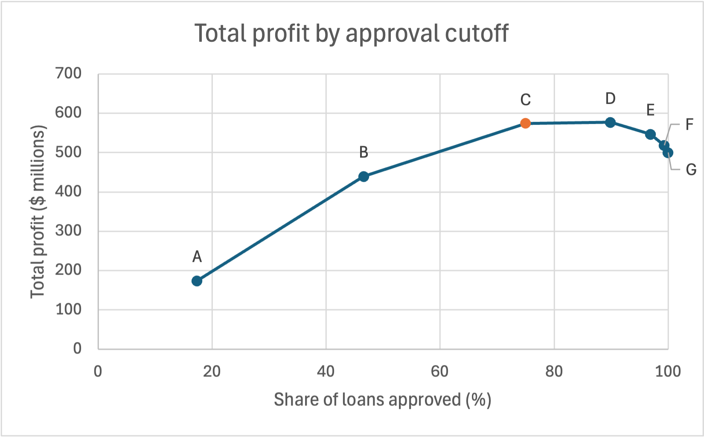

# Setting the Approval Cutoff for a Lender

At what risk grade should a lender stop approving loans to maximise profit? Using 1.35 million finished Lending Club loans, this analysis finds that **approving grades A to C captures 99.4% of the maximum possible profit while approving 75% of applicants**. Grades E to G lost money.

## Key findings
- **Default risk rises steadily with grade**, from 6% for grade A to almost 50% for grade G.
- **Riskier loans lose more when they default.** Lenders lost 54% of the amount lent on defaulted grade A loans, rising to 78% for grade G.
- **Higher interest doesn't cover the risk for the lowest grades.** Grades A to C were profitable, grade D roughly broke even, and grades E to G lost money.
- **Recommended cutoff: grade C.** Total profit peaked at a grade D cutoff ($577M), but grade C reached $573.8M while approving 75% of applicants instead of 90%. Approving every grade would have cost about $76M.

## Profit by grade
| Grade | Default rate | Interest earned per $100 | Lost per $100 | Profit per $100 |
|---|---|---|---|---|
| A | 6.0% | $8.60 | $3.20 | $5.30 |
| B | 13.4% | $13.10 | $8.00 | $5.10 |
| C | 22.4% | $17.30 | $14.90 | $2.50 |
| D | 30.4% | $21.50 | $21.40 | $0.10 |
| E | 38.4% | $26.20 | $28.10 | -$1.80 |
| F | 45.1% | $29.90 | $34.50 | -$4.60 |
| G | 49.7% | $29.10 | $38.50 | -$9.40 |

## Method
1. **Kept only finished loans** (fully paid or charged off), since loans still being repaid have no known outcome.
2. **Default rates by grade and vintage.** To compare years fairly, the vintage analysis used only matured 3-year loans issued 2007-2015, which had all reached their end date by 2018.
3. **Expected loss** = probability of default × loss given default × exposure.
4. **Profit curve:** running totals of profit and approval rate as each grade is added, then charted in Excel.

## Files
- `analysis.sql`: all SQL queries, with comments and findings
- `profit_curve.xlsx`: profit curve data and chart
- `profit_curve.csv`: profit curve data exported from SQL

## Limitations
- Profit ignores Lending Club's platform fees and the time value of money, so real profits would be somewhat lower, which makes grade C the safer cutoff.
- Only approved loans are analysed, so the results don't show how rejected applicants would have performed.

## Tools
SQLite (DB Browser for SQLite), Excel

## Data
[All Lending Club loan data](https://www.kaggle.com/datasets/wordsforthewise/lending-club) by Nathan George on Kaggle (2007-2018). Not included in this repository due to its size.
